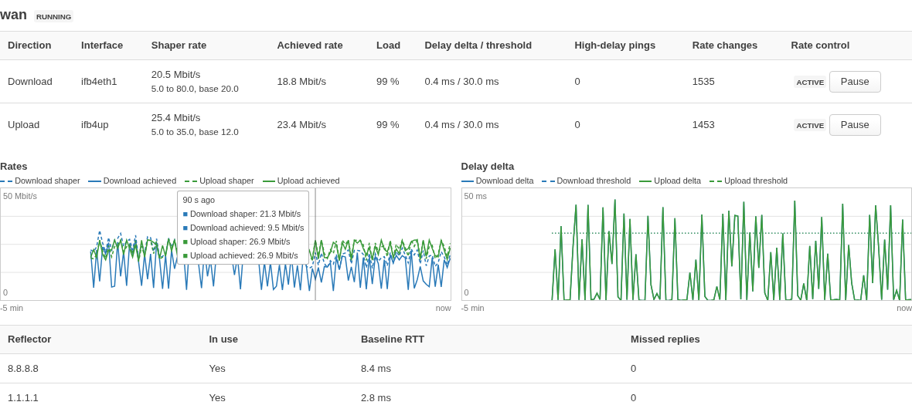

# cake-autorate-go

**A Go rewrite of [cake-autorate](https://github.com/lynxthecat/cake-autorate). It started as an experiment: how much fewer resources does a native program use than the original Bash scripts? Now, it also has changes to the algorithm for variable links such as 5G and Starlink: low bufferbloat and high throughput.**

> **WARNING:** This project is experimental, and AI tools wrote most of the
> code. The author still tests it. Use it at your own risk and with much
> caution: it can operate incorrectly or set incorrect rates on your traffic
> shaper. If you need a proven solution, use the
> [original cake-autorate](https://github.com/lynxthecat/cake-autorate).

## Attribution

This project is a Go reimplementation of [cake-autorate](https://github.com/lynxthecat/cake-autorate) by [lynxthecat](https://github.com/lynxthecat) and the contributors. The original algorithm, design and research are their work.

The original project has the [GPL-2.0](https://www.gnu.org/licenses/old-licenses/gpl-2.0.html) license. This rewrite has the same license.

## What it does

cake-autorate-go changes the bandwidth of CAKE shapers to follow the capacity of a variable link, for example LTE, 5G or Starlink. It measures the delay with pings and the load of the link. When the delay increases, it decreases the rate. When the link is busy and the delay is low, it increases the rate.



## Features

- **The algorithm of the original:** delay baselines with EWMA, bufferbloat detection, and the states Running, Idle and Stall. Also the replacement of a reflector that misses too many replies, and the compensation for the serialization delay.
- **One process for all links**, in one static binary. Netlink sets the CAKE bandwidth: no new process for each change.
- **One-way delays with ICMP timestamps** in the program (`ping_method: icmp-timestamp`), without an external pinger. A queue in one direction decreases only the rate of that direction.
- **Link modes** `latency`, `balanced` (default), `bandwidth` and `custom`: the trade-off between delay and throughput for each link. The LuCI status page changes the mode while the service runs, for some time or until a change.
- **Options for 5G links:** `learn_cross_delay` and `repeat_decrease_on_rise` (default off), `stall_recovery_ms` (default on, only with `icmp-timestamp`), and `refractory_on_decrease`, `increase_to_delay_thr` and `auto_max_rate` (set by the link mode). In the mode `latency`, with the default `ping_method` (`icmp`), the behavior stays near the original.
- **OpenWrt package with a LuCI app:** configuration of all settings and links, and a status page with graphs. From the browser, you can pause the rate control, turn the shaping off, calibrate a link and do a bufferbloat test.
- **`calibrate`** makes a proposed config from a test session on your link.
- **Config checks:** a warning for each unknown key, and for each reflector that is known to not reply to ICMP timestamp requests.
- **Recording and replay** of the controller inputs and decisions, a link simulator, and link emulations for the tests.

On a real 5G link (24 h, 14 sessions), the delay under load (p50) of cake-autorate-go is 7 to 9 ms lower than with the original, and the p99 is up to 41 ms lower. The original gets approximately 20 % more download. With the options `increase_to_delay_thr` and `refractory_on_decrease`, cake-autorate-go gets most of this download, with less delay than the original (p50 +4 to +6 ms, against +7 to +9 ms). On an emulated 5G link, the p95 is approximately 30 to 50 % lower. For the details, the differences from the original and the resource use on a router, see [docs/comparison.md](docs/comparison.md).

## Installation on OpenWrt

The releases have apk packages for OpenWrt 25.12 and later: the program `cake-autorate-go` and the LuCI app `luci-app-cake-autorate-go`. Download the two files of your architecture from the [Releases](https://github.com/megglos/cake-autorate-go/releases) page (for example `aarch64_cortex-a53` for the GL-MT6000). On the router:

```bash
cd /tmp
apk update
apk add --allow-untrusted ./cake-autorate-go-*.apk ./luci-app-cake-autorate-go-*.apk
```

Then:

1. Set up CAKE on the WAN with SQM QoS (`luci-app-sqm`): queue discipline `cake`, script `piece_of_cake.qos` or `layer_cake.qos`. The rates in SQM are only start values: the service changes them.
2. In LuCI, open **Network → CAKE Autorate (Go)**, tab **Configuration**. Edit the link `wan` (the package adds it): select the SQM queue in **SQM queue** (the page sets the interfaces), and set the rates. Add a link only for each other WAN. Select **Enabled** in **Service → General**: after the installation, the service is disabled. Then click **Save & Apply**.
3. Open the tab **Status**. If an interface has no CAKE, the page shows a warning.

For the UCI configuration, the LuCI pages and the build of the packages, see [docs/luci.md](docs/luci.md).

## Installation on other Linux systems

Download the binary for your platform from the [Releases](https://github.com/megglos/cake-autorate-go/releases) page, or build it:

```bash
go build -o cake-autorate-go .
GOOS=linux GOARCH=arm64 go build -o cake-autorate-go .   # for ARMv8
```

Requirements:

- **CAKE** on the download and the upload interface. The program changes only the bandwidth of CAKE: it does not set up CAKE. On a PC, [`scripts/cake-pc.sh`](scripts/cake-pc.sh) sets up CAKE and the IFB interface.
- **Root privileges**, or `CAP_NET_RAW` and `CAP_NET_ADMIN`: the program sends ICMP pings and sets the CAKE bandwidth through netlink. If netlink is not available, it uses `tc` (iproute2).

On OpenWrt without the package, [`setup.sh`](setup.sh) installs the binary, makes a default config and adds a procd service (see [docs/luci.md](docs/luci.md#without-the-package-setupsh)). Do not use it together with the package: both change the same shapers.

## Configuration

The LuCI app writes the configuration for you. Without LuCI, cake-autorate-go uses one YAML file (default: `/etc/cake-autorate/config.yaml`). Each setting has a default value, thus set only the values that are different for your link. A minimal config:

```yaml
links:
  - name: primary
    download:
      interface: ifb4wan        # The IFB with CAKE for the download
      adjust: true
      min_rate_kbps: 25000
      base_rate_kbps: 100000
      max_rate_kbps: 100000
    upload:
      interface: wan            # The WAN device with CAKE for the upload
      adjust: true
      min_rate_kbps: 5000
      base_rate_kbps: 35000
      max_rate_kbps: 35000
```

```bash
./cake-autorate-go --defaults                  # show all settings with their defaults
./cake-autorate-go -config FILE -check-config  # check a config file
sudo ./cake-autorate-go -config FILE           # run
```

Set `base_rate_kbps` to the usual speed of your link, `min_rate_kbps` to the lowest bandwidth that you can use, and `max_rate_kbps` to the maximum bandwidth. To measure these values on your link, use calibration ([docs/calibration.md](docs/calibration.md)).

For **5G and Starlink**, use `ping_method: icmp-timestamp`. The settings that gave the best results on a 5G link are in [docs/configuration.md](docs/configuration.md#5g-links).

[docs/configuration.md](docs/configuration.md) has all settings, more than one link, the reflectors, the status file, the control socket and the command-line options.

## Documentation

| Page | Content |
|---|---|
| [docs/luci.md](docs/luci.md) | OpenWrt package and LuCI app: installation, UCI, the LuCI pages, build and tests |
| [docs/configuration.md](docs/configuration.md) | All settings, 5G links, status file, control socket, command line |
| [docs/calibration.md](docs/calibration.md) | Measure your link and get a proposed config |
| [docs/comparison.md](docs/comparison.md) | Differences from the original, delay and throughput, resource use |
| [docs/recording.md](docs/recording.md) | Record test sessions on a real link |
| [docs/emulation.md](docs/emulation.md) | Emulate a variable link on a fast connection |
| [docs/development.md](docs/development.md) | Structure of the code, tests, simulator and tools |

## Status

This is an **experimental** project. The core algorithm comes from the original cake-autorate, with some changes. The larger changes for 5G links (see [5G links](docs/configuration.md#5g-links)) are options. The default link mode `balanced` turns on only `refractory_on_decrease`; the mode `latency` turns it off. The tests are emulations, a simulator and test sessions on one 5G link. The program is not yet tested much in daily use. Use it at your own risk and report problems as issues.

## License

This project has the GNU General Public License v2.0. See [LICENSE](LICENSE).

This is a derivative work of [cake-autorate](https://github.com/lynxthecat/cake-autorate), which also has the GPL-2.0 license.
