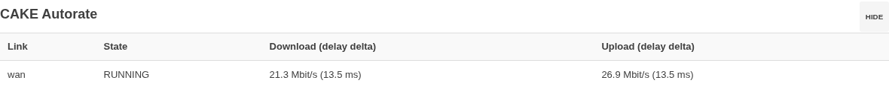
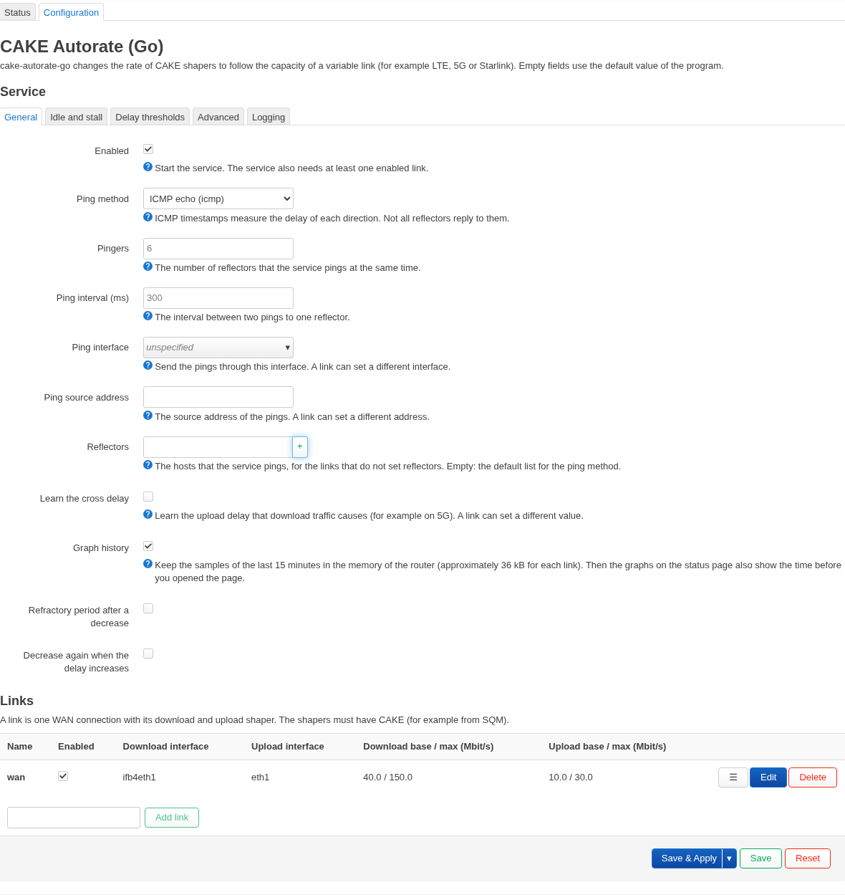
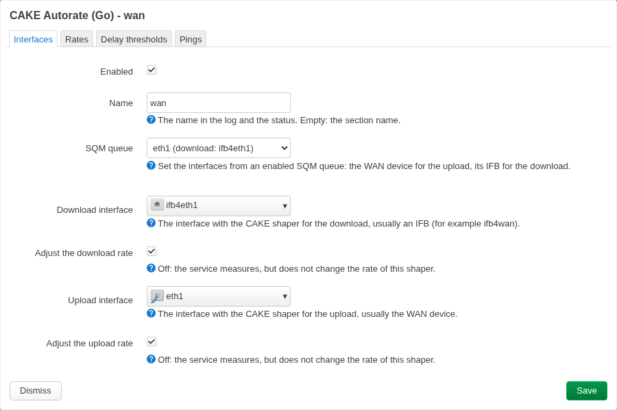

# OpenWrt package and LuCI app

This page describes the OpenWrt package of cake-autorate-go and its LuCI app. It has these topics: the installation, the UCI configuration, the LuCI pages, the build and the tests, and the installation without the package (`setup.sh`).

The directory [`openwrt/`](../openwrt) has the OpenWrt package `cake-autorate-go` and the LuCI app `luci-app-cake-autorate-go` (apk, OpenWrt 25.12 and later). The CI builds them for `aarch64_cortex-a53` (for example GL-MT6000) and `x86_64`. The package installs:

| File | Content |
|---|---|
| `/usr/sbin/cake-autorate-go` | the program |
| `/etc/config/cake-autorate` | the UCI configuration. The service is disabled at the start |
| `/etc/init.d/cake-autorate` | the procd service |
| `/usr/share/cake-autorate/` | the converter from UCI to the configuration file of the program |

## Install from a release

Each release has the apk files for each architecture. The name of a file has the architecture at the end, for example `cake-autorate-go-1.2.0-r1_aarch64_cortex-a53-openwrt-25.12.apk`. The LuCI app is the same for all architectures. On the router:

```bash
cd /tmp
# Download the two files of your architecture from the Releases page, then:
apk update
apk add --allow-untrusted ./cake-autorate-go-*.apk ./luci-app-cake-autorate-go-*.apk
```

`apk update` is necessary because apk installs the dependencies (for example `kmod-sched-cake`) from the OpenWrt feeds. The packages have no signature, thus `--allow-untrusted` is necessary.

Then:

1. Set up CAKE on the download and the upload interface, for example with SQM QoS (`luci-app-sqm`): queue discipline `cake`, script `piece_of_cake.qos` or `layer_cake.qos`. The rates in SQM are only start values: the service changes them.
2. In LuCI, open **Network → CAKE Autorate (Go)**, tab **Configuration**. Set the interfaces and the rates of the link. With SQM, select the queue in **SQM queue**: the page sets the interfaces. Select **Enabled** in **Service → General**: after the installation, the service is disabled. Then click **Save & Apply**.
3. Open the tab **Status**. If an interface has no CAKE, the page shows a warning.

## Configuration with UCI

The UCI options have the names of the configuration keys (see [Configuration reference](configuration.md#configuration-reference)). The section `global` has the global keys. Each section `link` is one link. A link has the keys of the download direction with the prefix `dl_` and the keys of the upload direction with the prefix `ul_`. An empty option uses the default value of the program, with two exceptions. If `dl_adjust` and `ul_adjust` are not set, they are `1`. The options `ping_interface` and `ping_source_addr` of the section `global` apply to each link that does not set them. Each link must set the interfaces and the rates. For example:

```
config global 'global'
	option enabled '1'
	option ping_method 'icmp-timestamp'

config link 'wan'
	option dl_interface 'ifb4wan'
	option dl_min_rate_kbps '5000'
	option dl_base_rate_kbps '20000'
	option dl_max_rate_kbps '80000'
	option ul_interface 'wan'
	option ul_min_rate_kbps '5000'
	option ul_base_rate_kbps '20000'
	option ul_max_rate_kbps '35000'
```

The name of the section is the name of the link. Set the option `name` to use a different name. Set `enabled '0'` in a link to stop the control of this link.

At each start, the service writes `/var/etc/cake-autorate.yaml` from the UCI configuration and checks it with `-check-config`. The errors and the warnings go to the system log (`logread -e cake-autorate`). If the configuration is not valid, the errors also go to `/var/run/cake-autorate/config-error`. The service writes the status file to `/var/run/cake-autorate/status.json` and listens on the control socket `/var/run/cake-autorate/control.sock`.

```bash
uci set cake-autorate.global.enabled=1
uci commit cake-autorate
/etc/init.d/cake-autorate enable
/etc/init.d/cake-autorate start
```

Do not use the package and the service of `setup.sh` at the same time: both change the same shapers.

## LuCI app

The package `luci-app-cake-autorate-go` adds the page **Network → CAKE Autorate (Go)** with two tabs: **Status** and **Configuration**.

### Status


The tab **Status** shows the state of each link: Running (green), Idle, or Stall (orange). For each direction, it shows the shaper rate, the measured rate, the load, the delay delta and its threshold. It also shows the number of pings with a high delay, the number of rate changes and the rate control (Active: green, Paused: blue). A high delay is orange (the program adds the time to send one packet at the shaper rate to the threshold). It also shows the reflectors with their baseline RTT and missed replies.

Each link has two graphs for the last 1, 5 or 15 minutes. One graph shows the shaper rates and the measured rates. The other graph shows the delay deltas and their thresholds. A pointer on a graph shows the values and the time of the sample. The other graph of the link shows a dashed line at the same time. With the keyboard, select a graph with Tab, then select a sample with the arrow keys, Home and End. **Graph history** is the option `status_history` in the tab General of the configuration. When it is on, the page gets the samples of the last 15 minutes from the program when it opens (control command `history`). Thus, the graphs also show the time before you opened the page. The program keeps the samples only in memory (approximately 36 kB for each link): a restart of the service starts with empty graphs. Without Graph history, the graphs show only the time since you opened the page. The page reads the status file each 2 seconds.

The button **Pause** sets the shaper of a direction to the base rate and stops the rate changes. **Resume** starts the control again. The pause stops at a restart of the service. Only a user with write permission for the app sees the buttons.

The label **Mode** shows the mode of the link (see [configuration.md](configuration.md#link-modes)). The button **Mode…** changes it while the service runs, without a restart: until a change, or for 1, 2 or 8 hours. After the time, or after a restart of the service, the link uses the mode of the configuration. For example, select **Bandwidth** for 1 hour for a large download, then the link goes back to **Balanced**. Only a user with write permission sees the button.

If an interface of a direction with rate control has no CAKE as root qdisc, the program cannot change the rate. Then the page shows a warning. Set up CAKE on the interface, for example with SQM QoS (`luci-app-sqm`). The page checks the interfaces each 10 seconds.



The **Overview** page of LuCI shows one row for each link. The row shows the state (with the labels of the tab Status), the shaper rates, the delay deltas and the pauses.

### Calibration

The button **Calibrate…** of a link (only with write permission) measures the link and proposes values for its configuration (see [calibration.md](calibration.md#online-calibration)). The program runs the session, and your browser makes the load: it downloads from and uploads to the speed test of Cloudflare (`speed.cloudflare.com`). Select the load time of each block (20, 40 or 80 s). The dialog shows the time and the data volume with the maximum rates of the link. A link that is faster than its maximum rate uses more data in the blocks without a shaper limit. The dialog shows the data that the load used. **Stop** stops the calibration, but then you get no result. Keep the page open until the end and do not use the network. In some blocks, the shaper of the link has no limit. At the end, the dialog shows the current and the proposed value of each setting, with the measured data. A value that is the same as the current value (of the link, of the global section or the default) is not selected. Select the values and click **Apply the selected values**. The page writes them to the link and applies the configuration. The activity threshold goes to the global section, for all links. The page refuses a selection that the service would refuse, for example a base rate above the maximum rate. A reload of the page during a session shows the session again and continues the load.

On a router with more than one WAN link (for example with mwan3), the routing selects the link of the browser traffic. During the calibration and the bufferbloat test, the service sends all traffic to `speed.cloudflare.com` through the link of the test (command `pin`, see [configuration.md](configuration.md#control-socket)). If this fails (for example, the link has no default route), the test runs, and the dialog shows a note. If the browser gets other addresses for `speed.cloudflare.com` (for example with DNS over HTTPS), the load can still use another link. Then the calibration shows a warning: the rate of the link was below half the rate of the browser. The bufferbloat test shows "load not on this link" in the phase.

The button **Bufferbloat test…** of a link (only with write permission) is a quick check of the configuration. Your browser makes the load in 4 phases (no load, download, upload, both; approximately 40 s), the same load as the calibration. The delay comes from the reflectors of the service. For each phase, the dialog shows the rates of the browser, and the median and the p95 of the delay delta in each direction. It also shows a grade for the larger median: A+ below 5 ms, A below 30 ms, B below 60 ms, C below 200 ms, D below 400 ms, else F. With **Compare without shaping**, the test runs a second time with the shaping off and shows the two results. Then only the run without shaping has the phase without load: without load, the shaping has no effect, and a link without shaping always has its pings. The service turns the shaping on again after the test, also if the page closes (after a time limit). The dialog shows the data that the load used. A link in Idle has no pings: start the test when the link is in use, or read the result of the load phases only.

### Configuration



The tab **Configuration** has:

- The section **Service**: the global settings in the tabs General, Idle and stall, Delay thresholds, Advanced and Logging. The field **Mode** in the tab General sets the mode of all links after a start. The options that the modes set (refractory period after a decrease, increase up to the bufferbloat threshold, learned maximum rate) show only in the mode **Custom**. In the other modes, they keep their values: a link in the mode Custom with "Global value" uses them.
- The section **Links**: a table with one row for each link. Use **Add link** to add a link. Use the edit button to change the interfaces, the rates, the delay thresholds and the ping settings of a link. The **Enabled** box in the row turns the control of the link on or off. The field **Mode** in the tab Rates of the link dialog sets a different mode for one link. In the mode Custom, the tab also shows the three options for the link (Global value, On or Off).

An empty field uses the default value of the program. The field shows this value in grey. The page checks the values before the save, for example the rates (minimum ≤ base ≤ maximum) and the interface names. Two links must not use the same interface. After **Save & Apply**, the service starts again with the new configuration. If the configuration is not valid, the page shows the errors of the service.



The shapers must have CAKE: set them up with SQM (`luci-app-sqm`) or `tc`, then select the same interfaces in the link. If `/etc/config/sqm` has a queue, the dialog shows the field **SQM queue**. It lists the enabled SQM queues. A queue sets the upload interface to the WAN device of the queue. It sets the download interface to the IFB of the queue: `ifb4` and the device name, cut to 15 characters. The dialog also shows a warning if no enabled SQM queue shapes an interface of the link with CAKE. Other CAKE setups (for example with `tc`) can ignore this warning.

## Build and test

To build the packages on your computer with Docker, run `scripts/openwrt-build.sh`. The packages go to `bin/openwrt/`.

To test the package without a router, use an OpenWrt x86-64 VM (QEMU with KVM). The CI does the same test:

```bash
scripts/openwrt-build.sh x86_64-25.12.5
scripts/openwrt-vm.sh start
scripts/openwrt-vm.sh install bin/openwrt/x86_64-25.12.5/*.apk
scripts/openwrt-vm-test.sh       # start, status, control socket, reload, stop, LuCI files
(cd openwrt/luci-app-cake-autorate-go/tests && npm ci && npx playwright install chromium && npx playwright test)  # LuCI pages in a browser
scripts/openwrt-vm.sh ssh        # shell in the VM; LuCI: http://localhost:8080
(cd openwrt/luci-app-cake-autorate-go/tests && node screenshots.js)  # the screenshots in docs/images (put load on the link first)
scripts/openwrt-vm.sh stop
```

The WAN of the VM is the QEMU user network. It sends only ICMP echo, not ICMP timestamps. For a live test with ICMP timestamps, give the VM a tap device of your computer as WAN. The comment at the start of `scripts/openwrt-vm.sh` shows the commands to set up the tap device and the NAT. Then start the VM with `VM_WAN_TAP`:

```bash
VM_WAN_TAP=cavtap0 scripts/openwrt-vm.sh start
```

The script sets a static WAN address in the VM. If a firewall on your computer drops forwarded packets (for example ufw or Docker), let the traffic of the tap device through.

The calibration and the bufferbloat test need the load of the browser on the WAN of the VM. `scripts/openwrt-vm-client.sh` makes a client behind the VM: a network namespace on your computer, with a tap device on the LAN of the VM. A browser in the namespace uses the VM as its router:

```bash
sudo scripts/openwrt-vm-client.sh up "$USER"
VM_WAN_TAP=cavtap0 VM_LAN_TAP=cavlan0 VM_CPUS=4 scripts/openwrt-vm.sh start
scripts/openwrt-vm-client.sh firefox   # LuCI: http://192.168.1.1
```

Do not use an SSH tunnel to the VM as a proxy for these tests. The tunnel sends all connections in one encrypted TCP connection. Then the delay of the browser can increase with the load, also without a queue in the shaper.

## Without the package: setup.sh

Run [`setup.sh`](../setup.sh) on your router. It installs the binary, makes a default config and makes a procd service:

```bash
# Copy the binary and the script to the router, then:
chmod +x setup.sh
./setup.sh ./cake-autorate-go
```

The script installs the binary to `/usr/sbin/cake-autorate-go`, makes a default config in `/etc/cake-autorate/config.yaml`, and adds the procd service `cake-autorate-go`. Then, do the instructions on the screen to configure, enable and start the service.

Do not use the package and the service of `setup.sh` at the same time: both change the same shapers.

## ubus methods

The LuCI app also installs an rpcd plugin, `/usr/share/rpcd/ucode/cake-autorate.uc`. It gives the ubus methods `cake-autorate pause` and `cake-autorate resume` (arguments `link` and optional `dir`, `dl` or `ul`) and sends them to the control socket. The method `cake-autorate history` gives the answer of the control command `history` as a JSON text in the field `data`. The method `cake-autorate qdisc` (argument `interface`) gives the kind of the root qdisc of an interface, for example `cake` or `fq_codel`. The methods `cake-autorate calibrate_start` (arguments `link` and optional `load_s`), `calibrate_status` and `calibrate_stop` control a calibration session (control command `calibrate`); only users with write permission have them. The method `cake-autorate mode` (arguments `link`, `mode` and optional `seconds`, 1 to 86400) sends the control command `mode`; only users with write permission have it.
